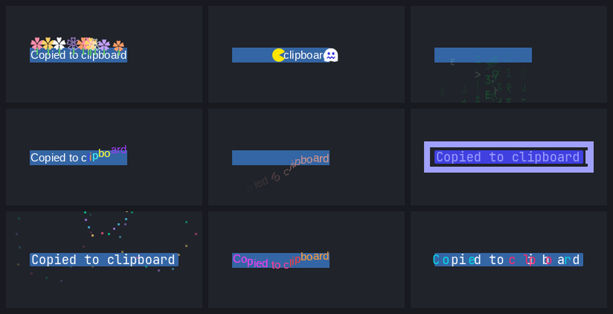

# CopyFX

<a href='https://ko-fi.com/akton1' target='_blank'></a>

An animation on the text you just copied, for the [Omarchy](https://omarchy.org/) shell. Select some text, press Ctrl+C, and the letters jump, rain, burst into flowers or get eaten by a round chomper, right where you selected them. About 120 effects, a gallery to try them, and colours that follow your theme.

> **Experimental.** This plugin is new and still being worked on. Expect rough edges, effects that change or get renamed, and settings that move between versions. Bug reports are welcome.



## Install

```
omarchy plugin add https://github.com/AktOn1/copyfx.git --enable
```

Then restart the shell once (`omarchy-restart-shell`) so the overlay loads.

## Requirements

- Omarchy with the shell plugin system and Hyprland.
- `wl-clipboard` (`wl-paste`), `jq`, `grim`, `curl`, `python`, `python-pillow`, `python-numpy`.

On Omarchy most of these are already there. If something is missing, the plugin lists the missing packages in the shell log and shows `missing: ...` in red in the gallery header. Install the packages it names (for example `grim`, `python-pillow`, `python-numpy`) with Omarchy's package install menu.

## First run

1. Open the gallery: `omarchy-shell shell toggle io.github.akton1.copyfx`
2. Click an effect (or move with the arrow keys and press Enter). It plays on the spot and stays selected.
3. Select some text anywhere and copy it.

The gallery does not dim the screen and clicks outside it pass through, so you can copy something and watch the effect straight away.

## Bar icon and menu

The plugin also adds a bar icon (a copy symbol with a sparkle). Add "CopyFX" to your bar in the Omarchy shell settings; it is under Appearance. Click it to open the menu: groups on the left (Favorites, All, then tag groups such as Playful, Retro or Nature), effects on the right, and On, Random, Surprise me and Gallery at the top.

Hover or move over an effect to preview it, click or press Enter to keep it. Keys: `hjkl` or arrows move, Enter keeps the effect and closes, Space previews, Tab jumps between groups, `f` toggles a favorite, `r` surprise me, `m` random mode, `e` on/off, `v` gallery, Esc closes. Favorites are saved in the plugin's own data folder. The menu can also be opened from a key: `omarchy-shell io.github.akton1.copyfx.menu toggle`.

The menu code is a small self-contained component (`SectionMenu.qml` and `MenuRow.qml`, copied into the plugin) that other plugins can copy and reuse (MIT licensed).

## Usage

**Gallery.** Drag the title to move it (double-click centres it again), arrows move, Enter chooses and plays, Esc closes, Tab cycles the size groups, `#tag` in the search box filters by tag. Shortcuts: Ctrl+R random mode, Ctrl+E on/off, Ctrl+F follow the theme, Ctrl+T "the current theme uses this effect", Ctrl+I the info chip.

A key for the gallery in `~/.config/hypr/bindings.lua`:

```lua
hl.bind("SHIFT + ALT + G", hl.dsp.exec_cmd("omarchy-shell shell toggle io.github.akton1.copyfx"),
  { description = "CopyFX gallery" })
```

**Try an effect from a script.**

```
omarchy-shell shell summon io.github.akton1.copyfx '{"test":"Hello","effect":"img-bloom"}'
```

**Copy-on-select apps and the Ctrl+C key.** Apps that copy as soon as you select (terminals) can be listed in `keyOnlyClasses` in the config. They then only get an effect when a copy key was pressed, which needs this non-consuming bind (the keys still reach the app):

```lua
for _, k in ipairs({ "CTRL + C", "CTRL + X", "CTRL + INSERT", "CTRL + SHIFT + C", "SUPER + C", "SUPER + X" }) do
  hl.bind(k, hl.dsp.exec_cmd([[omarchy-shell shell summon io.github.akton1.copyfx '{"copyKey":true}']]),
    { description = "CopyFX copy-key signal", non_consuming = true })
end
```

The window class of an app shows up in the log as `copyfx copy from class: ...` (`journalctl --user | grep "copyfx copy from"`).

**"Copy link address".** A link has no highlight, so the effect needs to know where you clicked. This optional bind passes the right-click position:

```lua
hl.bind("mouse:273", hl.dsp.exec_cmd([[omarchy-shell shell summon io.github.akton1.copyfx '{"rightClick":true}']]),
  { description = "CopyFX right-click position", non_consuming = true, dont_inhibit = true })
```

**Neovim and tmux.** Yanks in an editor have no mouse selection, so the program tells the plugin the colour of the highlight it just drew and the effect lands on it.

- Neovim: copy `integrations/nvim/copyfx.lua` to `~/.config/nvim/lua/copyfx.lua` and add `require("copyfx").setup()` to `init.lua`.
- tmux: `source-file` `integrations/tmux/copyfx.tmux.conf` (needs `bin/copyfx-yank` and `bin/copyfx-yank-pipe` on your `PATH`).
- Anything else: `printf %s "$text" | copyfx-yank '#rrggbb'`. The text is read from stdin and handed over through a private file, never as a command-line argument.

**Command-line tools** (in `bin/`; link them into `~/.local/bin` if you want them on your `PATH`):

- `notifyfx` shows any effect as a notification at a screen position: `notifyfx topright --text "Hello" --duration 2s`, `notifyfx --list-effects`.
- `copyfx` is a small developer helper (used by the dev reload).

**Adding an effect.** Create `effects/<id>/effect.json` and `effects/<id>/Effect.qml` whose root is `EffectBase` (inputs: `text`, `origin`, `fg`, `bg`, `accent`, `fontFamily`, `fontSize`, `compact`). Animate on `Component.onCompleted` and emit `finished()`. `tests/run-effect.sh <id>` runs one effect offscreen and prints its QML warnings.

## Configuration

`~/.local/share/omarchy-shell/copyfx/config.json`. Most of it is set from the gallery; the file is created on first change. Missing or invalid keys fall back to the defaults.

| Key | Default | Meaning |
| --- | --- | --- |
| `enabled` | `true` | Master switch. |
| `mode` | `"selected"` | `"selected"` plays the chosen effect, `"random"` picks one per copy. |
| `effect` | `"frame"` | Effect id of the chosen effect. |
| `maxChars` | `0` | Longest copy that plays an effect (`0` = no limit). |
| `fallback` | `"off"` | `"off"`: a copy whose selection cannot be located plays nothing. `"panel"`: draw a plain text panel instead. |
| `info` | `"off"` | Small chip next to the copied text (colour swatch, link, JSON, number, secret warning). `"smart"` or `"always"` turns it on. |
| `anchor` | `"selection"` | `"selection"` finds the highlight on screen. `"cursor"` skips the screenshot and starts at the mouse. |
| `durationMs` | `200` | Length of the on-text and by-image effects (30 to 5000). |
| `themeColors` | `true` | Effects use the colours of the current Omarchy theme. |
| `followTheme` | `false` | A theme switch also switches the effect. Your picks live in `theme-effects.json` next to the config, otherwise the shipped defaults apply. |
| `keyOnlyClasses` | `[]` | Window classes that only get an effect after a copy key press. |
| `sizes` | `["M"]` | Which size groups the gallery shows. |
| `devReload` | `false` | Developers only: allow the `reload` command that makes the shell load effects from an arbitrary folder. Leave it off. |

## Permissions and behaviour

What the plugin does on your machine, so you can decide whether to run it:

- **Clipboard and selection.** Two `wl-paste --watch` processes run all the time: one on the clipboard, one on the primary selection (the text you highlight). The text of a copy is handed to Omarchy's own clipboard `capture.sh` (which skips password-manager copies), and the selection watcher also ignores copies flagged as sensitive. The plugin keeps no history and writes copied text nowhere. Copied text is never put on a command line.
- **Screen capture.** To find where your selection is, the plugin takes a small screenshot around the mouse with `grim` right after you select and again when you copy (a small region, not the whole screen). It never leaves your machine. The images are processed in memory; for the effects that draw the selection as a picture, a PNG of just the selected text is written to `$XDG_RUNTIME_DIR/copyfx-sprites` (a private folder in the runtime dir) and kept for up to 300 seconds: files older than that are deleted the next time a detection runs, and the runtime dir is emptied at logout.
- **Network.** One call, to Open-Meteo (`api.open-meteo.com`), for the weather effects, with the coordinates from Omarchy's own weather widget settings (`~/.local/state/omarchy/settings/weather.json`). It only happens while a weather effect can play (gallery open, random mode, or a weather effect chosen), at most every 25 minutes, with a 10 second timeout and a 200 kB cap. No key, no account, no telemetry, no other network access.
- **Files it writes.** In `~/.local/share/omarchy-shell/copyfx/`: `config.json`, `theme-effects.json`, `weather.json` (last forecast) and `detect.log` (the last 300 detection results: screen coordinates, colours, timings; not the copied text). In `$XDG_RUNTIME_DIR`: `copyfx-sprites/` and, for a moment, `copyfx-yank.txt`.
- **Theme.** It reads `~/.local/state/omarchy/current/theme/colors.toml` and checks the theme name every 3 seconds.
- **IPC.** The overlay answers `omarchy-shell shell summon <id> '<json>'` commands: `test`, `notify`, `stop`, `copyKey`, `rightClick`, `yank`, `weatherTest` (and `reload` when `devReload` is on); the bar menu adds `menuState` and `set` (turn on/off, pick the effect or random mode; unknown effects are ignored). Any local program of yours can send these; they can only play effects, nothing else.
- **Text from outside** (the copied text, link addresses) is always drawn as plain text, never as markup.

## Update

```
omarchy plugin update io.github.akton1.copyfx
omarchy-restart-shell
```

## Remove

```
omarchy plugin remove io.github.akton1.copyfx
rm -rf ~/.local/share/omarchy-shell/copyfx
```

The second line deletes your config and weather cache. Remove the Hyprland binds you added.

## Troubleshooting

- **Nothing plays.** Check the gallery header (is it `OFF`? is something `missing:`?) and the log: `journalctl --user -f | grep copyfx`.
- **"no selection found and fallback is off".** The highlight could not be located (a copy button, a context menu, an app that does not draw a highlight). Set `"fallback": "panel"` to always get a plain panel, or leave it quiet.
- **Terminal copies play twice or at the wrong time.** Add the app's window class to `keyOnlyClasses` and add the copy-key bind.
- **Link copies only show a panel.** Add the right-click bind.
- **Weather effects look like day/night only.** The weather widget has no location yet, or there is no network.
- **Effect changes do not show.** The shell caches effect QML until `omarchy-restart-shell`.

Run the checks with `node tests/logic.test.js`.

## Support

If this brightens your copy-paste, you can support the work on Ko-fi:

<a href='https://ko-fi.com/akton1' target='_blank'></a>

## License

MIT. See [LICENSE](LICENSE).
